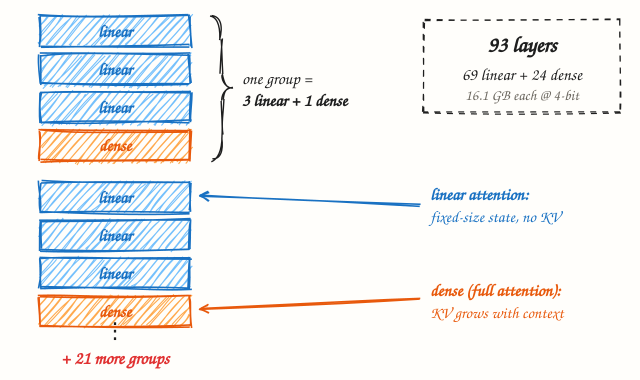
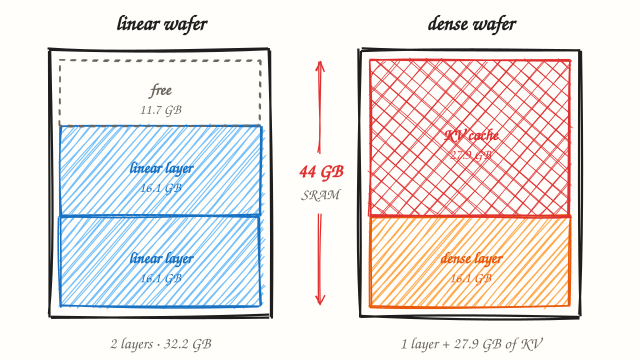
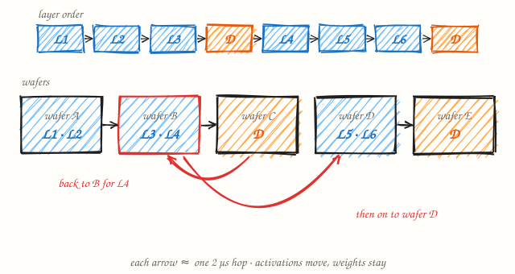
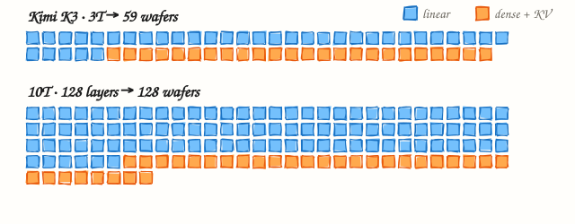

# How a 3-trillion-parameter model fits on 59 wafers

*Working through the Cerebras whiteboard for Kimi K3 on WSE-3T, one marker line at a time: weights, KV cache, layer mapping. Then the same math for 10 trillion.*

**Sagor0078** · Nov 2, 2026 · 8 min read

---

In [“Deploying Trillion-parameter Frontier Models”](https://youtu.be/efqQMmvSsVE), Cerebras CTO Sean Lie stands at a whiteboard with three red headings on it: **#1 Weights**, **#2 KV cache (dense)** and **#3 Layer mapping**. Under each is a line of arithmetic with the answer left blank. This post fills in the blanks.

The point of the exercise is simple. A Cerebras wafer has no HBM. Everything lives in on-chip SRAM, 44 GB per WSE-3T wafer. So the question “how do you serve a 3T model?” turns into a packing problem: how many 44 GB boxes do you need, and what goes in each one?

## The setup

Top right of the board, in a bracket, are the facts everything else hangs on:

| | |
|---|---|
| **Model** | Kimi K3 · ~3T |
| **Layers** | 69 linear + 24 dense |
| **Context** | 256K tokens |
| **Weights** | 4-bit |
| **KV cache** | 8-bit |
| **Per wafer** | 44 GB SRAM |

Down the left side, the 93 layers are drawn as repeating groups: three **linear** attention layers, then one **dense** (full-attention) layer, then “21 more groups.” The distinction matters for memory. A linear-attention layer carries a fixed-size state per request, no matter how long the context gets. A dense layer keeps a key and value for every token it has seen, so its KV cache grows with the context.

*Fig. 1. The layer stack, as drawn on the board. Only the orange layers need a KV cache.*

## #1 · Weights

Two lines on the board. First the total, then the per-layer share.

| | | |
|---|---|---|
| total model size | 3×10¹² params × 4 bits ÷ 8 bits/byte | **1,500 GB** |
| GB / layer | 1,500 GB ÷ 93 layers | **16.1 GB** |

1.5 TB is far more than a wafer, but 16.1 GB per layer is well under 44 GB. That is the fact the whole design rests on. Every layer fits whole on one wafer, so no layer has to be split, the weights never move, and the only thing that travels between wafers is the activation for each token.

## #2 · KV cache (dense)

Give each dense layer its own wafer and whatever SRAM is left after the weights becomes KV cache.

| | | |
|---|---|---|
| memory for KV | 44 GB − 16.1 GB | **27.9 GB** |
| KV size of each req | bytes per token × 256K tokens | **10.7 GB** |
| # of concurrent req | 27.9 GB ÷ 10.7 GB | **2** |

The middle line is the one I can’t fully read. The presenter’s arm covers part of it; what’s visible looks like “40k ×”. If that means about 40 KB per token for one dense layer, a 256K-token request needs 10.7 GB of KV on each dense wafer, and only two of them fit. With a compact latent KV cache of the kind DeepSeek V3 and Kimi K2 use (576 bytes per token per layer at 8-bit), the same wafer holds 184. Here is how the answer moves with the KV size per token:

| KV bytes per token, per dense layer | KV per request, per wafer | Concurrent 256K requests | KV per request, all 24 layers |
|---|---:|---:|---:|
| Latent KV · 576 B | 0.15 GB | **184** | 3.6 GB |
| GQA, 8 heads · 2 KB | 0.54 GB | **51** | 12.9 GB |
| GQA, 64 heads · 16 KB | 4.3 GB | **6** | 103.1 GB |
| Board reading · 40 KB | 10.7 GB | **2** | 257.7 GB |

Concurrency is set by the dense wafers alone. Each one holds the KV for its own layer for every request in flight, so the number of requests that fit on one dense wafer is the number the whole pipeline can serve at full context. Shorter requests fit more.

*Fig. 2. What goes in each 44 GB wafer, drawn to scale. Linear layers pair up; a dense layer takes a wafer and fills the rest with KV cache.*

## #3 · Layer mapping

Linear layers don’t need KV room, so two fit on a wafer (2 × 16.1 = 32.2 GB of 44). Dense layers get one wafer each.

| | | |
|---|---|---|
| linear layers | 69 layers ÷ 2 per wafer = 34.5 → | **35 wafers** |
| dense layers | 24 layers ÷ 1 per wafer = | **24 wafers** |
| TOTAL # WAFERS | 35 + 24 = | **59 wafers** |

That matches the 59 Cerebras quotes. One detail the board skips: layers come in groups of three linear and one dense, and three doesn’t divide by two. To reach 35, the odd linear layer of one group has to share a wafer with the first linear layer of the next group, on the far side of a dense layer. The token goes out to the dense wafer and comes back.

*Fig. 3. Two groups of the pipeline. Wafer B holds L3 and L4, so each token passes through it twice. Without that sharing, each group needs two linear wafers and the total is about 70, not 59.*

Each hop between wafers is about 2 µs over RDMA. A token crossing 59 wafers spends roughly 116 µs on the network before any compute, which still leaves room for the 1,000–2,000 tokens per second Cerebras reports. Pipeline depth also gives concurrency for free: with one micro-batch per stage, 59 stages means 59 batches in flight.

## What about 10 trillion parameters?

Apply the same three steps to 10T. There is no public 10T configuration, so I kept Kimi K3’s mix of one dense layer in four and tried three depths, with latent KV at 576 bytes per token.

| | | |
|---|---|---|
| total model size | 10×10¹² × 4 bits ÷ 8 = | **5,000 GB** |
| floor, weights only | 5,000 GB ÷ 44 GB = 113.6 → | **114 wafers** |

| Layers | GB / layer | KV room / dense wafer | Wafers | 256K requests | Hop latency |
|---|---:|---:|---:|---:|---:|
| Kimi K3 · 93 (69 + 24) | 16.1 | 27.9 GB | 59 | 184 | 116 µs |
| 10T · 93 (70 + 23) | 53.8, split ×2 | 34.2 GB | 186 | 226 | 370 µs |
| **10T · 128 (96 + 32)** | **39.1** | **4.9 GB** | **128** | **32** | **254 µs** |
| 10T · 192 (144 + 48) | 26.0 | 18.0 GB | 192 | 118 | 382 µs |

*Fig. 4. One square per wafer. Blue holds linear layers, orange holds a dense layer and its KV cache.*

Three things change at 10T.

- **Linear layers stop pairing up.** At 26–54 GB a layer, two no longer fit in 44 GB, so the trick that saved 34 wafers on K3 is gone. Every linear layer costs a full wafer.
- **The cheapest layout starves the KV cache.** At 128 layers each layer is 39 GB, which leaves under 5 GB per dense wafer. That is 32 full-context requests, down from 184.
- **You buy concurrency with wafers.** Going deeper (192 layers) or splitting fat layers across two wafers frees KV room again, at 190 wafers or so. Roughly three times K3’s footprint for three times the parameters, with the network hops growing in step.

> On a wafer-scale machine the whole sizing exercise is three lines of arithmetic. The hard part is choosing which number to give up: wafers, context length or concurrency.

---

### Assumptions and sources

1. Board numbers, the 59-wafer total and the 2 µs hop come from the video and Cerebras’ post [“How we deploy trillion-parameter frontier models on Cerebras”](https://www.cerebras.ai/blog/how-we-deploy-trillion-parameter-frontier-models-on-cerebras).
2. The per-token KV figure on the board is partly hidden; “40 KB” is my reading. Latent KV (576 B) is an assumption borrowed from DeepSeek V3 and Kimi K2, not a published K3 figure.
3. Weights are split evenly over layers; embeddings, norms and router weights are ignored. Concurrency counts KV only, so activations and linear-attention state lower it in practice.
4. The 10T configurations are hypothetical. The calculator that produced the table is [`10t_model/calc.py`](../calc.py).
