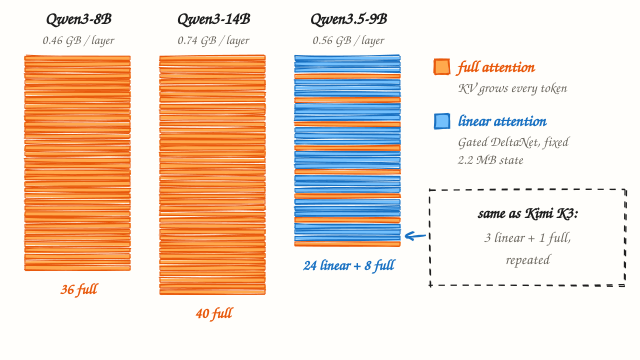
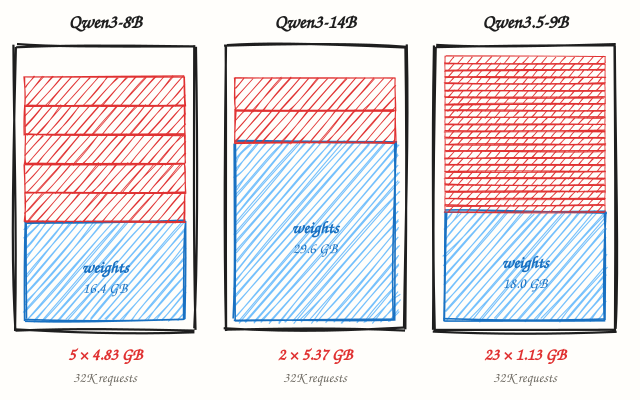
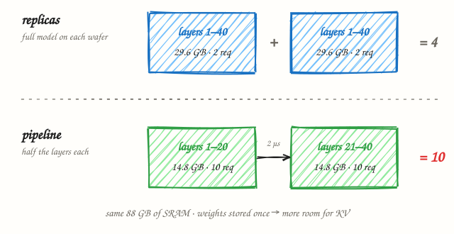

# Qwen on six chips: from an L40S to Vera Rubin to a Cerebras wafer

*The Cerebras whiteboard math for Qwen3-8B, Qwen3-14B and Qwen3.5-9B, run on six machines. Memory size decides how many conversations fit. Memory speed decides how fast they run.*

**Sagor0078** · Nov 3, 2026 · 8 min read

---

In [“Deploying Trillion-parameter Frontier Models”](https://youtu.be/efqQMmvSsVE), Cerebras sizes Kimi K3, a model of about 3 trillion parameters, with three lines of whiteboard arithmetic: **#1 Weights**, **#2 KV cache**, **#3 Layer mapping**. The answer was 59 wafers ([I worked through it here](kimi-k3-wafers.md)).

A wafer is one Cerebras chip, the size of a dinner plate, with 44 GB of SRAM on it. What happens if you run the same three steps on a model hundreds of times smaller? Here are three of Alibaba’s open Qwen models in the size class most people actually deploy.

## The setup

Two dense Qwen3 models, where every layer is full attention, and one Qwen3.5 hybrid. The hybrid stacks layers in groups of three linear-attention layers (Gated DeltaNet) and one full-attention layer. That is the same pattern drawn down the left side of the Kimi K3 whiteboard.

| | Qwen3-8B *(dense)* | Qwen3-14B *(dense)* | Qwen3.5-9B *(hybrid)* |
|---|---|---|---|
| **Params** | 8.2 B | 14.8 B | 9 B |
| **Layers** | 36 full attn | 40 full attn | 24 linear + 8 full |
| **Heads** | 32 Q · 8 KV | 40 Q · 8 KV | 16 Q · 4 KV (full attn) |
| **Head size** | 128 | 128 | 256 |
| **Context** | 32K (128K YaRN) | 32K (128K YaRN) | 256K native |

All three: 16-bit (BF16) weights and KV cache · requests sized at 32K tokens · 44 GB SRAM per wafer.

*Fig. 1. Orange layers keep a KV cache that grows with every token. Blue layers keep a fixed-size state. Qwen3.5-9B has the Kimi K3 pattern at 1/300th the size.*

## #1 · Weights

| Model | | | |
|---|---|---|---|
| **Qwen3-8B** | total model size | 8.2×10⁹ × 16 bits ÷ 8 bits/byte | **16.4 GB** |
| | GB / layer | 16.4 GB ÷ 36 layers | **0.46 GB** |
| **Qwen3-14B** | total model size | 14.8×10⁹ × 16 bits ÷ 8 bits/byte | **29.6 GB** |
| | GB / layer | 29.6 GB ÷ 40 layers | **0.74 GB** |
| **Qwen3.5-9B** | total model size | 9.0×10⁹ × 16 bits ÷ 8 bits/byte | **18.0 GB** |
| | GB / layer | 18.0 GB ÷ 32 layers | **0.56 GB** |

For Kimi K3 this step gave 1,500 GB, 34 wafers’ worth of memory just for weights. Here every model fits whole on one wafer at full 16-bit precision. The 8B and 9B take under half of it; the 14B takes two thirds.

## #2 · KV cache

Whatever the weights don’t use becomes KV cache. Each token stores a key and a value for every KV head in every full-attention layer: 2 × layers × KV heads × head size × bytes. Linear-attention layers instead keep one fixed-size state per request, however long it runs.

| Model | | | |
|---|---|---|---|
| **Qwen3-8B** | memory for KV | 44 GB − 16.4 GB | **27.6 GB** |
| | KV per token | 2 × 36 layers × 8 KV heads × 128 × 2 bytes | **144 KB** |
| | KV size of each req | 144 KB × 32,768 tokens | **4.83 GB** |
| | # of concurrent req | 27.6 GB ÷ 4.83 GB = 5.7 → | **5** |
| **Qwen3-14B** | memory for KV | 44 GB − 29.6 GB | **14.4 GB** |
| | KV per token | 2 × 40 layers × 8 KV heads × 128 × 2 bytes | **160 KB** |
| | KV size of each req | 160 KB × 32,768 tokens | **5.37 GB** |
| | # of concurrent req | 14.4 GB ÷ 5.37 GB = 2.7 → | **2** |
| **Qwen3.5-9B** | memory for KV | 44 GB − 18.0 GB | **26.0 GB** |
| | KV per token | 2 × 8 full layers × 4 KV heads × 256 × 2 bytes | **32 KB** |
| | linear state | 24 layers × 2.2 MB, fixed per request | **52 MB** |
| | KV size of each req | 32 KB × 32,768 tokens + 52 MB | **1.13 GB** |
| | # of concurrent req | 26.0 GB ÷ 1.13 GB = 23.1 → | **23** |

Here is the surprise. The two dense models are almost out of room after a handful of conversations: 5 for the 8B, 2 for the 14B. The 9B hybrid is *larger* than the 8B, yet it holds 23. Only 8 of its 32 layers keep a growing cache, so each token costs 32 KB instead of 144 KB. It is the same reason Kimi K3 only needed KV room on 24 of its 93 layers.

*Fig. 2. One wafer each, drawn to scale. Every red slice is the cache of one 32K-token request.*

Precision and context length move these numbers a lot. Concurrent 32K-token requests on one wafer:

| Weights → | 16-bit | 16-bit | 8-bit | 8-bit | 4-bit | 4-bit |
|---|---:|---:|---:|---:|---:|---:|
| **KV cache →** | **16-bit** | **8-bit** | **16-bit** | **8-bit** | **16-bit** | **8-bit** |
| Qwen3-8B | 5 | 11 | 7 | 14 | 8 | 16 |
| Qwen3-14B | 2 | 5 | 5 | 10 | 6 | 13 |
| Qwen3.5-9B | 23 | 44 | 31 | 59 | 35 | 67 |

Dropping the 14B weights to 4-bit frees 22 GB and takes it from 2 to 6 requests at 32K. Halving the KV cache to 8-bit roughly doubles concurrency on any of them. Long context is where the designs split apart:

| Concurrent requests, one wafer, 16-bit | 4K | 32K | 128K | 256K |
|---|---:|---:|---:|---:|
| Qwen3-8B | 45 | 5 | 1 | *beyond max* |
| Qwen3-14B | 21 | 2 | 0 | *beyond max* |
| **Qwen3.5-9B** | **139** | **23** | **5** | **3** |

At 128K tokens one Qwen3-14B request needs 21.5 GB of cache, more than the wafer has left. The hybrid still serves 5 at that length, and 3 at its full native 256K.

## #3 · Layer mapping

| | | |
|---|---|---|
| Qwen3-8B | 36 layers, 16.4 GB → all on one wafer = | **1 wafer** |
| Qwen3-14B | 40 layers, 29.6 GB → all on one wafer = | **1 wafer** |
| Qwen3.5-9B | 32 layers, 18.0 GB → all on one wafer = | **1 wafer** |
| network hops | no wafer-to-wafer traffic = | **0 µs** |

The answer to step three is one wafer, so the more useful question is how to grow past it. Add a second wafer and there are two ways to use it.

*Fig. 3. Two wafers, Qwen3-14B, 32K context. Splitting the layers stores the weights once, so more SRAM goes to KV cache.*

- **Replicas.** Put a full copy of the model on each wafer. Each serves 2 requests on its own, 4 in total. No traffic between wafers, but the 29.6 GB of weights is stored twice.
- **Pipeline.** Put layers 1–20 on one wafer and 21–40 on the other, the way Kimi K3 was spread over 59. Each wafer holds 14.8 GB of weights and 29.2 GB of KV, and each request needs only 2.68 GB per wafer because it’s only half the layers. That’s **10** requests, two and a half times as many, at the cost of one 2 µs hop per token.

The others gain less: Qwen3-8B goes from 10 to 14, and Qwen3.5-9B from 46 to 62. The smaller the share of the wafer that’s left for KV, the more it pays to store the weights only once, which is why the 14B gains the most.

## Why put a small model on a wafer at all?

On a GPU, generating each token means reading all the weights out of HBM. That sets a ceiling on how fast one conversation can go: memory bandwidth divided by model size.

| Memory | Bandwidth | 8B (16.4 GB) | 9B (18.0 GB) | 14B (29.6 GB) |
|---|---:|---:|---:|---:|
| H100 SXM, HBM3 | 3.35 TB/s | ≈ 205 tok/s | ≈ 185 tok/s | ≈ 115 tok/s |
| H200, HBM3e | 4.8 TB/s | ≈ 295 tok/s | ≈ 265 tok/s | ≈ 160 tok/s |
| WSE-3, on-chip SRAM | 21 PB/s | ≈ 1.3 M tok/s | ≈ 1.2 M tok/s | ≈ 710 K tok/s |

The wafer’s ceiling is so far out that it stops being the limit; compute and the rest of the system set the real speed. That is the actual case for wafer-scale on small models. Capacity was never the issue at 8B. Bandwidth is.

## What about 2× L40S?

Most people asking “what fits?” have a GPU server, not a wafer. So here is the same math on a common one: two NVIDIA L40S cards, built on the Ada Lovelace architecture. One L40S has 48 GB of memory, almost exactly a wafer’s 44 GB. What differs is how fast that memory can be read, and how the two cards talk to each other.

| | 1× L40S | 2× L40S | 1 wafer |
|---|---:|---:|---:|
| Memory | 48 GB GDDR6 | 96 GB | 44 GB SRAM |
| Usable for the model | ≈ 43 GB | ≈ 86 GB | 44 GB |
| Memory bandwidth | 864 GB/s | 2 × 864 GB/s | ≈ 21 PB/s |
| Link between devices | PCIe Gen4, no NVLink | PCIe Gen4, no NVLink | 2 µs RDMA hop |
| FP8 tensor cores | yes | yes | – |

I’ve reserved about 10% of each card for the CUDA runtime, activations and fragmentation, which is what serving engines like vLLM hold back by default. With 32K-token requests in 16-bit, two cards can run either one full copy of the model each, or one copy split across both (tensor parallel):

| 32K requests, 16-bit | Weights | One copy per GPU | Split across both |
|---|---:|---:|---:|
| Qwen3-8B | 16.4 GB | 5 + 5 = 10 | 14 |
| Qwen3-14B | 29.6 GB | 2 + 2 = 4 | 10 |
| **Qwen3.5-9B** | **18.0 GB** | **22 + 22 = 44** | **60** |

It is the same pattern as the two-wafer pipeline: store the weights once and more memory goes to KV cache, so the 14B gains most from splitting. Per card, an L40S lands within one request of a wafer, because the capacity is nearly the same.

*Fig. 4. Qwen3.5-9B, one copy per device, 32K requests, to scale. The memory holds the same thing; reading it once takes 21 ms on an L40S and under a microsecond on the wafer.*

**FP8 changes the picture on L40S.** Ada’s tensor cores run FP8 natively, and Qwen publishes official FP8 builds of Qwen3. At FP8 the 14B’s weights drop to 14.8 GB, and one copy per GPU holds 5 + 5 = 10 conversations with no traffic between the cards.

Speed is where the GPU gives ground. Every new token reads all the weights, so bandwidth sets a ceiling for a single conversation:

| Single-stream ceiling | 1 GPU, 16-bit | 1 GPU, FP8 | 2 GPUs split, FP8 |
|---|---:|---:|---:|
| Qwen3-8B | ≈ 53 tok/s | ≈ 105 tok/s | ≈ 210 tok/s |
| Qwen3-14B | ≈ 29 tok/s | ≈ 58 tok/s | ≈ 117 tok/s |
| Qwen3.5-9B | ≈ 48 tok/s | ≈ 96 tok/s | ≈ 192 tok/s |

The split numbers will come in 10–20% lower in practice, because without NVLink every layer synchronises the two cards over PCIe. With every slot busy, the KV cache has to be read too, so total throughput per GPU at 16-bit is about 440 tokens/s for Qwen3.5-9B, 107 for Qwen3-8B and only 43 for Qwen3-14B.

What I’d run on 2× L40S:

- **For the most conversations and long context:** Qwen3.5-9B, one copy per GPU. 44 conversations at 32K, up to 256K tokens, and nothing crosses PCIe.
- **For the strongest model here:** Qwen3-14B in FP8, one copy per GPU. 10 conversations at about 58 tok/s each, no PCIe traffic. Split it across both cards only when you need more than 10 conversations or BF16 accuracy.
- **Avoid:** Qwen3-14B in 16-bit as one copy per GPU. Two conversations per card.

## How A100, H200, B200 and Vera Rubin compare

The L40S is the smallest card here. The data-center GPUs above it add two things: more memory, and much faster memory. That runs from the A100 through Hopper (H200) and Blackwell (B200) to Vera Rubin, NVIDIA’s 2026 platform that pairs the Rubin GPU with the Vera CPU. Here is one GPU of each, next to the wafer, with the same 10% held back on every GPU.

| One device | Memory | Usable | Bandwidth | Link to next device | FP8 |
|---|---:|---:|---:|---:|---:|
| L40S | 48 GB GDDR6 | 43 GB | 0.86 TB/s | PCIe Gen4, 64 GB/s | yes |
| A100 80GB SXM | 80 GB HBM2e | 72 GB | 2.0 TB/s | NVLink 3, 600 GB/s | *no* |
| H200 SXM | 141 GB HBM3e | 127 GB | 4.8 TB/s | NVLink 4, 900 GB/s | yes |
| B200 | 180 GB HBM3e | 162 GB | 8.0 TB/s | NVLink 5, 1.8 TB/s | yes, + FP4 |
| Rubin (Vera Rubin) | 288 GB HBM4 | 259 GB | 22 TB/s | NVLink 6, 3.6 TB/s | yes, + NVFP4 |
| 1 wafer (WSE-3T) | 44 GB SRAM | 44 GB | ≈ 21,000 TB/s | 2 µs RDMA hop | – |

| 32K conversations, one device, 16-bit | L40S | A100 | H200 | B200 | Rubin | Wafer |
|---|---:|---:|---:|---:|---:|---:|
| Qwen3-8B | 5 | 11 | 22 | 30 | 50 | 5 |
| Qwen3-14B | 2 | 7 | 18 | 24 | 42 | 2 |
| **Qwen3.5-9B** | **22** | **47** | **96** | **127** | **214** | **23** |

*Fig. 5. Qwen3-14B in 16-bit, one device each, memory to scale. Capacity sets how many conversations fit; bandwidth sets how long one pass over the weights takes.*

Capacity decides concurrency. An H200 or B200 holds 18–24 full Qwen3-14B conversations on one card, nine to twelve times an L40S. One Rubin GPU holds 42, and 214 of the hybrid Qwen3.5-9B. By capacity alone, one wafer is an L40S.

**Single-stream ceiling** (tokens/s, 16-bit, one device):

| | L40S | A100 | H200 | B200 | Rubin | Wafer |
|---|---:|---:|---:|---:|---:|---:|
| Qwen3-8B | 53 | 124 | 293 | 488 | 1,341 | ≈ 1.3 M |
| Qwen3-14B | 29 | 69 | 162 | 270 | 743 | ≈ 710 K |
| Qwen3.5-9B | 48 | 113 | 267 | 444 | 1,222 | ≈ 1.2 M |

**Total with every 32K slot busy** (tokens/s, 16-bit, one device):

| | L40S | A100 | H200 | B200 | Rubin | Wafer |
|---|---:|---:|---:|---:|---:|---:|
| Qwen3-14B | 43 | 212 | 684 | 1,212 | 3,622 | *compute-bound* |
| Qwen3.5-9B | 444 | 1,352 | 3,655 | 6,312 | 18,185 | *compute-bound* |

Bandwidth decides speed, and here the gap runs the other way. A B200 is about nine times faster than an L40S at reading its memory, and Rubin’s HBM4 is another 2.75 times faster again, 25 times an L40S. The wafer is still about 950 times faster than Rubin. On every GPU a single conversation is limited by memory reads; on the wafer it isn’t.

A few things the tables don’t show:

- **2× L40S against one A100.** The pair has more memory (96 GB against 80), so a split Qwen3-14B fits 10 conversations against the A100’s 7. But the A100 reads memory 2.4 times faster per card and needs no PCIe hop, so each conversation runs faster.
- **A100 has no FP8 tensor cores.** FP8 checkpoints still load and halve the memory, but the math runs in 16-bit, so the speed gain is smaller than on L40S, H200 or B200.
- **B200 adds FP4.** At 4 bits Qwen3-14B takes 7.4 GB and the single-stream ceiling roughly quadruples. Whether quality holds at FP4 depends on the model and the checkpoint.
- **Splitting pays less on big cards.** Two H200s split over NVLink barely gain, because one card already has plenty of room for KV. Splitting is a fix for small cards like the L40S.
- **Vera Rubin is built for the other end of this blog.** A 14B model uses about a ninth of one Rubin GPU. The platform ships as racks of 72 GPUs (Vera Rubin NVL72, about 20.7 TB of HBM4), aimed at models like Kimi K3: its 1.5 TB of 4-bit weights fit in the memory of six Rubin GPUs, where Cerebras needs 59 wafers to hold weights and KV cache.

> At 3 trillion parameters the whiteboard asks how many wafers hold the model. At 9 billion it asks how many conversations fit beside it, and the answer depends on how many layers forget.

---

### Assumptions and sources

1. Method, the 44 GB of SRAM per WSE-3T wafer and the 2 µs hop are from the Cerebras video and their post [“How we deploy trillion-parameter frontier models on Cerebras”](https://www.cerebras.ai/blog/how-we-deploy-trillion-parameter-frontier-models-on-cerebras).
2. Shapes are from the published `config.json` and model cards of Qwen3-8B, Qwen3-14B and Qwen3.5-9B on Hugging Face. Qwen3 runs 32K natively and up to about 128K with YaRN, so 256K is outside its supported range.
3. Qwen3.5-9B is counted as its 9 B-parameter language model, served text-only. The full checkpoint is about 10 B with the vision encoder and multi-token-prediction head, which would take about 2 GB more.
4. Linear-attention state per layer: 32 value heads × 128 × 128 in FP32 (2.1 MB) plus a small convolution buffer. Concurrency counts cache only; activations and scratch memory lower it in practice.
5. Bandwidth ceilings are bytes of weights read per token, single stream, no batching. The 21 PB/s figure is Cerebras’ published number for WSE-3; I assumed WSE-3T is no slower.
6. L40S figures (48 GB GDDR6, 864 GB/s, PCIe Gen4 x16, no NVLink, FP8 support) are from NVIDIA’s L40S datasheet. 10% of each card is held back for the runtime. All L40S numbers are calculations from specs, not measurements; real serving adds kernel and scheduling overhead.
7. A100 80GB SXM (2.0 TB/s, NVLink 3), H200 SXM (141 GB, 4.8 TB/s, NVLink 4) and B200 (180 GB as listed for DGX/HGX B200, 8 TB/s, NVLink 5) are from NVIDIA’s datasheets; B200 was first announced at 192 GB. Rubin (288 GB HBM4, 22 TB/s, NVLink 6 at 3.6 TB/s) uses NVIDIA’s Vera Rubin NVL72 launch figures; a September 2026 report says NVIDIA revised these to 19.2 TB/s and 3 TB/s, which would lower Rubin’s speed numbers by about 13% and leave its capacity numbers unchanged. Same 10% reserve on every GPU. Full-load throughput assumes every slot holds a full 32K context and each step reads the weights plus all KV once.
